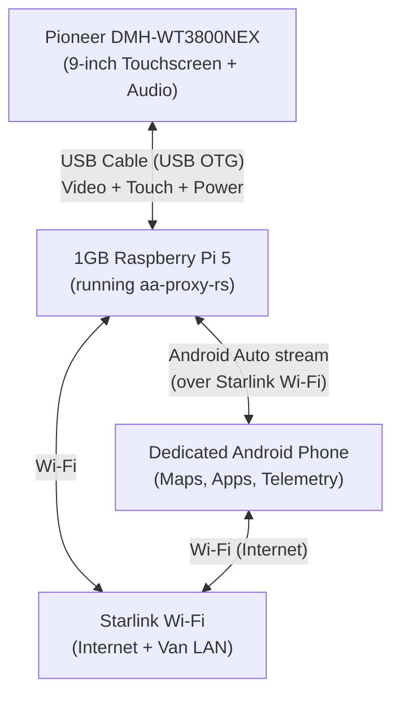

# Proposed Head Unit Bridge — 1GB Raspberry Pi 5 (`aa-proxy-rs`)

## Problem

Gomtuu's cab head unit is a **Pioneer DMH-WT3800NEX** (9-inch 1024×600 capacitive touchscreen, wired and wireless Android Auto / CarPlay, no HDMI input).

When an Android phone connects to the DMH-WT3800NEX via **Wireless Android Auto**, the Pioneer spins up an isolated 5 GHz Wi-Fi access point (`[Select Wi-Fi] -> [Smartphone]` mode) and forces the phone to disconnect from Starlink Wi-Fi to join the Pioneer's private network. Because the Pioneer has no internet uplink of its own, Android falls back to cellular data. In remote areas with no cell signal, the phone loses all internet connectivity (breaking navigation, maps, streaming, and cloud queries) even though Starlink is live in the van.

Additionally, the DMH-WT3800NEX's `[Hotspot]` Wi-Fi client mode (which connects the receiver to an external router for built-in Pioneer weather/OTA widgets) is mutually exclusive with Wireless Android Auto and does not route internet to a connected phone.

## Proposed Architecture

Wire the **1GB Raspberry Pi 5** directly to the Pioneer head unit's rear USB port in **USB Gadget (OTG) mode**, running [`aa-proxy-rs`](https://github.com/aa-proxy/aa-proxy-rs), while a **dedicated Android phone** (and/or any phone in the van) remains connected to **Starlink Wi-Fi**.

### Connection Flow

1. **Dedicated Android Phone ↔ Starlink Wi-Fi**: The phone stays on Starlink Wi-Fi continuously, keeping full internet access, Tailscale connectivity, and MQTT telemetry (`gps/phone/#`, etc.) without needing USB-C Ethernet adapters or cab wiring to the phone.
2. **1GB Raspberry Pi 5 ↔ Starlink Wi-Fi**: The 1GB Pi 5 joins the same Starlink Wi-Fi network (and Tailscale).
3. **1GB Raspberry Pi 5 ↔ Pioneer DMH-WT3800NEX (Wired USB OTG)**:
   - Connected via the Pi 5's USB-C port (configured in peripheral/OTG mode) to the Pioneer's USB port.
   - Powered directly by the Pioneer's USB port (up to 1.5A / 7.5W, while the Pi 5 in headless bridge mode draws ~2.5–3.5W), so the Pi powers on automatically with the head unit and draws 0W when the head unit is off.
4. **Phone ↔ 1GB Pi 5 (over Starlink Wi-Fi)**:
   - On boot, `aa-proxy-rs` advertises over Bluetooth to the phone.
   - Instead of spinning up a separate Wi-Fi hotspot that pulls the phone off Starlink, `aa-proxy-rs` (in client/station mode) directs the phone to open the Android Auto projection stream to the Pi's IP on the existing Starlink Wi-Fi LAN.
   - `aa-proxy-rs` pipes the H.264 video and audio stream into the Pioneer over USB and forwards all capacitive touch events, microphone input, and button presses from the Pioneer back to the phone.

---

## 1GB Raspberry Pi 5 Software Stack

Because this node acts as a thin, headless hardware bridge that is hard-powered-off whenever the head unit or ignition turns off, fast boot time (~3–5 seconds) and power-loss immunity (running from RAM / read-only rootfs) take priority over running a full Debian install.

### Layer-by-Layer Stack

1. **Base OS (In-RAM Embedded Linux)**:
   - Runs entirely in RAM (`tmpfs` / read-only `squashfs`) so cutting power at the head unit never corrupts the SD card.
   - Prototype target: **Alpine Linux (`aarch64` Diskless Mode)**.
   - Long-term appliance target: **Custom Buildroot Image (`aa-proxy-buildroot`)**.
2. **Linux Kernel USB Gadget Subsystem (`dwc2` + `ConfigFS`)**:
   - `/boot/firmware/config.txt` enables peripheral mode on the Pi 5's USB-C port: `dtoverlay=dwc2,dr_mode=peripheral`.
   - Kernel module `libcomposite` exposes `/sys/kernel/config/usb_gadget`.
   - Presents **AOAP (Android Open Accessory Protocol)** descriptors (`VID 0x18D1`, `PID 0x2D00`/`0x2D01`) to the Pioneer's USB port so the head unit recognizes the Pi as a wired Android phone.
3. **Bridge Daemon (`aa-proxy-rs`)**:
   - Single compiled `aarch64` Rust binary using `io_uring` for low-latency USB ↔ TCP forwarding.
   - Manages the `BlueZ` Bluetooth handshake, `ConfigFS` USB gadget state transitions, and the local web UI.
   - Runs in **MITM (Man-in-the-Middle) mode** (using the 5 extracted GAL `.pem` certificate/key files in `/etc/aa-proxy-rs/`) to terminate the phone and head-unit TLS sessions independently, enabling:
     - **Resolution & DPI override**: Forces a crisp `1280×720` video container and lowers reported DPI (e.g. `100`–`120` instead of the stock `160+`) so UI elements and the Android Auto dock bar don't look oversized on the `1024×600` Pioneer panel.
     - **Motion lockout removal**: Strips driving-status restrictions so keyboards and long lists remain usable while the van is moving.
     - **On-the-fly channel muxing**: Enables switching the video and touch channels between the phone and a local Pi stream (see below).
4. **Tailscale & Headless Management (`tailscaled` + `dropbear`)**:
   - Static `arm64` `tailscale` / `tailscaled` binaries baked into the image, initialized in the background *after* `aa-proxy-rs` starts so Tailscale never delays the Android Auto handshake on boot.
   - State file (`tailscaled.state`) stored on the persistent data partition alongside `aa-proxy-rs`'s `config.toml` and Bluetooth pairing keys so the node keeps its tailnet identity across reboots.
   - **Headless config & updates**:
     - **Tailscale SSH** (`tailscale up --ssh`) provides authenticated SSH over the tailnet directly through `tailscaled` with no extra daemon overhead.
     - **Dropbear SSH** (included by default in both Alpine and `aa-proxy-buildroot`) provides lightweight (~100 KB) local LAN SSH fallback.
     - **`aa-proxy-rs` Web UI & OTA**: Exposes a built-in HTTP configuration interface and supports over-the-air firmware/config updates.

---

## OS Image Comparison: Raspberry Pi OS Lite vs. Alpine Diskless vs. Buildroot

| Metric | Raspberry Pi OS Lite (Debian) | Alpine Linux (Diskless RAM Mode) | Custom Buildroot (`aa-proxy-buildroot`) |
|---|---|---|---|
| **Role in Plan** | Not recommended (too heavy) | **Phase 1 Prototype** | **Phase 2 Production Appliance** |
| **Boot Time (Power → AA Ready)** | ~20–30 seconds | **~4–6 seconds** | **~3–5 seconds** |
| **Idle RAM Usage** | ~150–200 MB | **~35–50 MB** | **~25–40 MB** |
| **Image Size** | ~2.5 GB | **~60–90 MB** | **~40–70 MB** |
| **Hard Power-Off Safety** | Read-write `ext4` by default (risks SD corruption unless `overlayfs` is maintained) | **100% RAM rootfs** (changes saved explicitly via `lbu commit`) | **100% RAM / read-only `squashfs`** (separate `/data` partition for config) |
| **Pi 5 Support** | Native out of the box | **Native out of the box** (`alpine-rpi-aarch64`) | Requires adding `raspberrypi5` board target to `aa-proxy-buildroot` |
| **Adding Tailscale** | `apt install tailscale` | **`apk add tailscale`** + `lbu commit` | Drop static `arm64` binaries into Buildroot `rootfs_overlay` |
| **Iteration Speed** | Fast (live package manager) | **Fast** (live `apk` + commit to SD) | Slower (~30–45 min initial cross-compile per image build) |

---

## How Android Auto Actually Works with the Head Unit

The Pioneer DMH-WT3800NEX does not run Android Auto apps locally; it acts strictly as a remote H.264 video display, capacitive touchscreen digitizer, speaker, and microphone.

1. **Virtual Display & H.264 Encoding on the Phone**:
   - The Android Auto system service on the phone creates an off-screen virtual display, renders the interface (status bar, app dock, split-screen "Coolwalk" cards, Google Maps, Waze, etc.), encodes it in real time to **H.264 video**, and streams the packets out.
2. **Multiplexed TLS Channels**:
   - Whether connected over USB (`AOAP` — Android Open Accessory Protocol) or Wi-Fi (bootstrapped via Bluetooth, then streamed over a TCP socket), the wire protocol is an identical multiplexed Protocol Buffers stream inside a mutual-TLS tunnel (`Google Automotive Link` / GAL):
     - **Video Sink (Phone → Head Unit)**: H.264 video frames (`800×480`, `1280×720`, `1920×1080`, or `2560×1440` — notably, `1024×600` is not a native AA container size, so forcing `1280×720` + lowering DPI via `aa-proxy-rs` avoids blurry `800×480` upscaling).
     - **Touch / Input Source (Head Unit → Phone)**: Raw multi-touch coordinates (`DOWN`, `MOVE`, `UP` `(x, y)`), steering-wheel controls, and hardware buttons.
     - **Audio Sinks (Phone → Head Unit)**: Three independent audio streams — Media (music), Guidance/TTS (navigation & assistant prompts with audio ducking), and Telephony.
     - **Microphone Source (Head Unit → Phone)**: Raw PCM audio from the wired cab microphone.
     - **Sensor Channel (Head Unit → Phone)**: Headlight day/night state, driving/parking-brake status, etc.

Because `aa-proxy-rs` bridges this protocol transparently, **100% of standard Android Auto (Google Maps, Waze, Spotify, split-screen view) continues to work normally** while gaining Starlink internet access. Custom GOMAC interfaces sit alongside them as additional icons in the Android Auto app launcher.

---

## Phone-Side App Tiers: Locked Templates vs. Unlocked `CarActivity` / `WebView`

Android Auto apps on the phone fall into two distinct models depending on whether they follow Google Play Store restrictions or use Android Auto's Developer Mode ("Unknown Sources").

### Tier 1: Locked Standard Templates (`androidx.car.app` & `MediaBrowserService`)
Google restricts Play Store apps to sending structured data into fixed templates rather than drawing pixels:
- **`MediaBrowserService`**: Used for audio apps (e.g., exposing GOMAC's Pandora/pianobar controls and station list inside the 1/3 split-screen media card right next to Google Maps).
- **`androidx.car.app` Templates (`GridTemplate`, `ListTemplate`, `PaneTemplate`)**: Used by the official Home Assistant Android app (and available to a custom GOMAC app) for quick status tiles, sensor readouts, and toggle buttons.
- **Limitations**: Cannot draw custom layouts, charts, gauges, `WebView`s, or terminals.

### Tier 2: Unlocked Custom Surface (`CarActivity` + Developer Mode "Unknown Sources")
By enabling **Developer Settings → Unknown Sources** in the phone's Android Auto settings, sideloaded apps built against the OEM projection API (`com.google.android.gms.car` / `CarActivity`) receive a raw Android `Window` and `Surface` on the head unit's virtual display.

- **What Unlocked `CarActivity` Can Do (No Phone Root Required)**:
  - Render **any custom Android UI** (`View`, `Canvas`, `Jetpack Compose`, OpenGL) or a **full Chromium `WebView`** (WebSockets, SVG, Canvas, JS) with full capacitive multi-touch (pinch, drag, swipe) and an in-window on-screen keyboard.
  - Run existing open-source `CarActivity` wrappers like **Fermata Auto** today with zero custom Android code to load GOMAC's live telemetry dashboard (`http://theflea:8091`) or an interactive `bash` terminal (via `ttyd` / `xterm.js` running on TheFlea or the 1GB Pi 5).
  - Or embed a thin `WebView` / native Kotlin screen directly inside GOMAC's own Android app.
- **What Remains Different in Unlocked `CarActivity`**:
  1. **The Android Auto Taskbar (~10% of screen)**: Because the phone's Android Auto service still composites the outer frame, the Android Auto dock/rail stays visible along one edge (useful for one-tap switching back to Google Maps/Waze, and shrunk down via `aa-proxy-rs`'s DPI override, but not 100% edge-to-edge).
  2. **Unmodified Third-Party APKs**: Only apps compiled with `CarActivity` (or web apps hosted inside a `CarActivity` `WebView`) render natively on the car display without root screen-mirroring (`Screen2Auto`).
  3. **OS Permission Dialogs**: First-time Android OS permission prompts appear on the phone screen rather than the dash (can be pre-granted once on the phone or via `adb install -g`).
  4. **DRM Video (`Widevine L1` / `FLAG_SECURE`)**: Commercial paid video apps block virtual-display capture; non-DRM video, cameras, and all custom UIs/canvases render normally.

---

## Direct Pi H.264 Stream & On-the-Fly TLS Channel Switching (True 100% Fullscreen)

For cases where we want **true 100% edge-to-edge fullscreen (`1024×600` / `1280×720` with no Android Auto dock bar at all)** — or want the 1GB Pi 5 to drive the Pioneer screen directly when no phone is connected — the 1GB Pi 5 can generate and inject its own H.264 stream over USB.

### Why This Is Possible
When `aa-proxy-rs` runs in **MITM mode**, there is no single end-to-end TLS session between the phone and the Pioneer. Instead, `aa-proxy-rs` terminates two separate TLS connections using the extracted Google Automotive Link certificates (`hu_cert.pem`/`hu_key.pem` facing the phone; `md_cert.pem`/`md_key.pem` + `galroot_cert.pem` facing the Pioneer, as documented in open-source projects like `AACS` and `vehiculum`).

Inside the 1GB Pi 5's Rust process, every Android Auto channel is already decrypted and demultiplexed:
- **Channel 3 (Video Sink)**: H.264 NAL units going to the Pioneer.
- **Channel 1 (Touch / Input Source)**: `(x, y)` touch events coming from the Pioneer.
- **Channel 4 (Media Audio)**: Stereo audio from the phone going to the cab speakers.

### How On-the-Fly Switching Works
1. **Default ("Android Auto" Mode)**:
   - `aa-proxy-rs` forwards Channel 3 (Video) and Channel 1 (Touch) between the phone and the Pioneer with near-zero CPU overhead.
2. **Switch to Direct Pi Stream (Triggered via App Button or MQTT Command)**:
   - The USB connection and TLS session to the Pioneer remain live — no USB reset or reconnect delay.
   - On **Channel 3 (Video)**, `aa-proxy-rs` pauses forwarding the phone's video frames, injects an H.264 IDR keyframe (`SPS`/`PPS` + I-frame) from a local display/framebuffer on the 1GB Pi 5 (`x264 --preset ultrafast --tune zerolatency`), and streams the Pi's own full-screen UI (`100%` of the display, zero Android Auto frame).
   - On **Channel 1 (Touch)**, `aa-proxy-rs` stops forwarding touch coordinates to the phone and routes them to Linux's `/dev/uinput` virtual touchscreen device on the Pi.
   - **Channel 4 (Audio)** from the phone (music or Google Maps voice navigation prompts) can continue playing through the cab speakers uninterrupted while the screen shows the Pi's full-screen terminal or dashboard.
3. **Exit Back to Android Auto**:
   - Tapping an Exit button on the Pi UI (or sending an MQTT command) requests a fresh keyframe (`VideoFocusRequest`) from the phone and switches Channel 3 and Channel 1 back to the phone stream on the next frame tick.

*(Note: While `aa-proxy-rs` already implements the USB gadget layer, dual-TLS MITM termination, and channel demuxing out of the box, adding the local H.264 socket input + `/dev/uinput` touch muxer is a custom Rust extension we would add to our fork of `aa-proxy-rs` when ready for true edge-to-edge Pi streaming.)*

---

## Dedicated Android Phone: Mounted Sensor, Projection, & Co-Pilot Node

Because the dedicated Android phone connects to the 1GB Pi 5 over Starlink Wi-Fi rather than needing to sit in the cab or be plugged into the dash, it can be permanently mounted out of the way (e.g., positioned with a clear view for security camera use and sky/GPS reception) and treated as a multi-sensor appliance node.

### 1. Onboard Telemetry & Sensor Roles
A single modern Android phone packs hardware sensors that would otherwise require several separate ESP32/I2C modules, all publishable to Mosquitto (`gomac/phone/state/#` or existing `gps/phone/#` topics):
- **GPS / GLONASS**: Continuous `latitude`, `longitude`, `altitude`, `speed`, `bearing`, and `accuracy` (solving the May 2026 Starlink local-API GPS removal).
- **Van Leveling (3-Axis Accelerometer / Gravity Sensor)**: Continuous **Pitch (°)** and **Roll (°)** measurements. Given Gomtuu's 144" wheelbase and track width, pitch and roll angles translate directly into exact leveling-block heights per wheel when parking.
- **Environmental**: Barometric pressure (`hPa`, altitude/weather trend), ambient light (`lux`), and magnetometer compass heading.
- **Security Camera / Interior Monitoring**: Built-in camera(s) streaming RTSP/WebRTC or motion snapshots over the local LAN/Tailscale.
- **Android Auto Projection Engine**: Drives the Pioneer DMH-WT3800NEX display over Starlink Wi-Fi via `aa-proxy-rs`.

### 2. Passenger Co-Pilot / Navigator Workflow (Decoupling Personal Phones from the Dash)
When a personal phone is connected directly to Android Auto, the passenger navigator is locked out of normal map research, and modifying routes or adding stops while moving can interrupt the driver's turn-by-turn view at critical interchanges. Decoupling the **Dedicated Dash Phone** from the **Navigator's Personal Phone** resolves this in three ways:
1. **Motion Lockouts Removed on the Dash (`DRIVING_STATUS_UNRESTRICTED`)**:
   - `aa-proxy-rs` rewrites the Pioneer's `SensorBatch` driving status packets on the wire to `UNRESTRICTED` (parked), keeping the Pioneer's on-screen keyboard, "Add a stop" search, and list scrolling unlocked at all times while in motion.
2. **Independent Research & Route Pushing**:
   - The passenger researches freely on their personal phone (Google Maps, iOverlander, Campendium, weather radar) without touching the driver's live navigation screen.
   - **Single-destination push**: Sending a standard `google.navigation:q=<lat>,<lon>` (or address) Android Intent to the dedicated phone switches the Pioneer's active Google Maps destination immediately in place.
   - **Multi-stop caveat & leg-by-leg queuing**: Android Auto's Google Maps receiver strips or ignores the `waypoints=` parameter on external `ACTION_VIEW` intents. To drive a multi-stop route remotely without using the Pioneer's on-screen "Add stop" button, GOMAC holds the multi-stop itinerary and pushes one leg at a time (`Stop 1`, then `Stop 2` upon arrival/skip) via `google.navigation:q=`.
3. **"Show This to the Driver" (Screen Push)**:
   - The navigator can push a view (map, radar, campsite photo, or GOMAC screen) from their personal phone to the dash either by foregrounding the dedicated phone's `CarActivity` / `WebView` window or by triggering the 1GB Pi 5's H.264 stream switch.

### 3. Headless Remote Management (`scrcpy` over Wi-Fi) & Battery Preservation
Because the dedicated phone may be mounted out of easy physical reach, it must remain 100% controllable remotely (including across reboots and OS permission prompts) without physical touch:
- **Persistent Wireless `adb` + `scrcpy`**:
  - Stock Android resets `adb tcpip 5555` on reboot. To survive reboots unattended:
    - **Rooted appliance phone (preferred)**: Set `persist.adb.tcp.port=5555` via a boot script (`/data/adb/service.d/`) so `adb` is always reachable over LAN/Tailscale immediately after boot. Also enables `scrcpy --turn-screen-off` so the phone's physical OLED screen stays powered off (0W display draw, no burn-in) while being controlled remotely.
    - **USB-tethered fallback (if powered via a Pi USB port)**: A `udev` rule on the Pi runs `adb tcpip 5555` automatically whenever the phone enumerates on USB.
- **Browser-Accessible `scrcpy` (`ws-scrcpy` on TheFlea)**:
  - Running `ws-scrcpy` on TheFlea exposes the dedicated phone's screen and touch input as a web page on the local LAN/tailnet — allowing the navigator to view and control the mounted phone from a personal phone, bedroom iPad, or laptop browser without needing a desktop `scrcpy` client.
- **24/7 Charge Limiting (Preventing Battery Swelling)**:
  - Keeping a lithium-ion phone battery at 100% SOC continuously in a warm vehicle cab risks battery swelling. The dedicated phone should enforce a hardware charge limit (e.g., 50–60% via Magisk `acc` Advanced Charging Controller on a rooted phone, or built-in 80% battery protection on supported Pixel/Samsung devices).

---

## Implementation Path

### Stage 1: Prototype on Alpine Linux (Diskless Mode)
- Flash official `alpine-rpi-aarch64` onto the 1GB Pi 5 SD card.
- Configure `config.txt` (`dtoverlay=dwc2,dr_mode=peripheral`) and load `libcomposite`.
- Configure `wpa_supplicant` for Starlink Wi-Fi and install `bluez`, `tailscale`, and the compiled `aarch64` `aa-proxy-rs` binary.
- Ensure the OpenRC init order starts `aa-proxy-rs` immediately after local networking/Bluetooth and launches `tailscaled` asynchronously in the background.
- Persist configuration (`config.toml`, Bluetooth keys, `/var/lib/tailscale/tailscaled.state`) to the SD card via `lbu commit`.

### Stage 2: Production Buildroot Image (`aa-proxy-buildroot`)
- Fork/extend `aa-proxy-buildroot` with a `raspberrypi5` board configuration (Pi 5 kernel + RP1 peripheral drivers + `dwc2` USB-C gadget tree).
- Add a Buildroot `rootfs_overlay` containing:
  - Static `tailscale` and `tailscaled` binaries in `/usr/sbin/`.
  - An init script starting `tailscaled --state=/data/tailscale/tailscaled.state` in the background.
- Produce a single flashable `.img` / `.swu` firmware artifact for the 1GB Pi 5.
