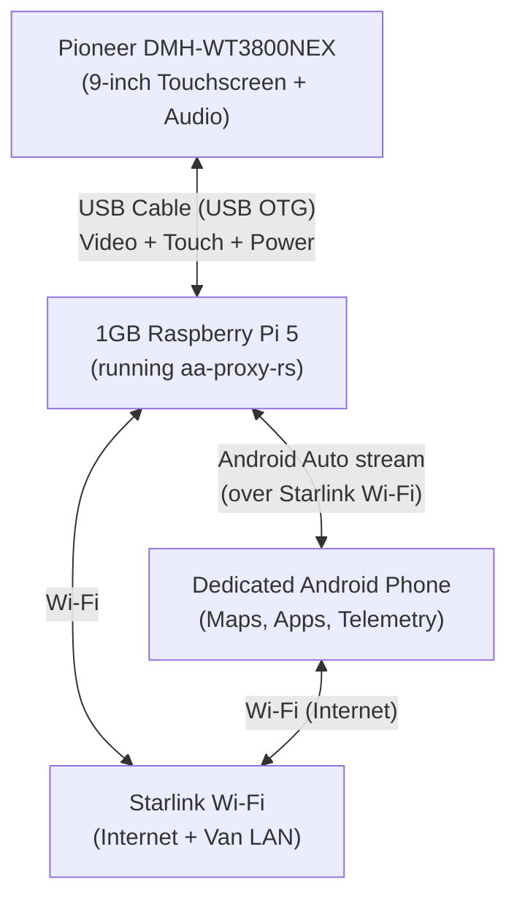

# Proposed Head Unit & Co-Pilot Architecture

## 1. System Overview

This layout pairs a **USB-connected Linux SBC bridge** (a 1GB Raspberry Pi 5 running [`aa-proxy-rs`](https://github.com/aa-proxy/aa-proxy-rs)) at the dash head unit with a **mounted Android appliance node** connected to the vehicle's **Starlink / local Wi-Fi LAN**.

### Topology & Data Flow

1. **Vehicle Wi-Fi LAN (Starlink)**: Provides the shared local network and internet uplink for both the Android node and the Raspberry Pi bridge.
2. **Dedicated Android Node ↔ Vehicle Wi-Fi**: Remains on the vehicle Wi-Fi LAN continuously for internet access, Tailscale connectivity, and MQTT telemetry publishing (`gps/phone/#`, `gomac/phone/state/#`). Because it does not join the head unit's isolated 5 GHz Wi-Fi hotspot, it never loses internet access when cellular coverage drops.
3. **1GB Raspberry Pi 5 ↔ Head Unit (USB OTG)**: Connects to the Pioneer DMH-WT3800NEX (9-inch `1024×600` capacitive touchscreen, no HDMI input) via USB-C in peripheral/gadget mode. The head unit's USB port supplies power (up to 1.5A / 7.5W vs. the Pi's ~2.5–3.5W bridge draw), so the bridge powers on and off with the dash.
4. **Android Node ↔ 1GB Raspberry Pi 5 (over Vehicle Wi-Fi)**: On boot, `aa-proxy-rs` completes the Bluetooth bootstrap with the Android node and directs it (in client/station mode) to stream its Android Auto TCP projection session over the existing vehicle Wi-Fi LAN. The Pi pipes H.264 video and audio into the head unit over USB and returns capacitive touch, microphone audio, and hardware button events to the Android node.

---

## 2. Android Auto Protocol & Wire Model

An Android Auto head unit does not execute apps locally; it acts as a remote H.264 video display, capacitive touchscreen digitizer, speaker, and microphone.

1. **Virtual Display & H.264 Encoding**: The Android Auto service on the phone creates an off-screen virtual display, renders the interface (status bar, app dock, split-screen "Coolwalk" cards, Google Maps, Waze, etc.), and hardware-encodes it in real time to **H.264 video**.
2. **Multiplexed TLS Channels (`Google Automotive Link` / GAL)**: Over both USB (`AOAP` — Android Open Accessory Protocol) and Wi-Fi TCP, the wire protocol is a multiplexed Protocol Buffers stream inside a mutual-TLS tunnel:
   - **Channel 1 — Touch / Input Source (Head Unit → Phone)**: Multi-touch coordinates (`DOWN`, `MOVE`, `UP` `(x, y)`), steering-wheel controls, and hardware buttons.
   - **Channel 3 — Video Sink (Phone → Head Unit)**: H.264 frames (`800×480`, `1280×720`, `1920×1080`, or `2560×1440` — `1024×600` is not a native container size).
   - **Channel 4+ — Audio Sinks (Phone → Head Unit)**: Three separate streams — Media (music), Guidance/TTS (navigation/assistant prompts with audio ducking), and Telephony.
   - **Microphone Source (Head Unit → Phone)**: Raw PCM audio from the cab microphone.
   - **Sensor Channel (Head Unit → Phone)**: Headlight day/night state, driving/parking-brake status, etc.

Because the bridge proxies this protocol transparently, **standard Android Auto (Google Maps, Waze, Spotify, split-screen view) operates normally** over Starlink internet, while custom GOMAC interfaces sit alongside them in the Android Auto app launcher.

---

## 3. Head Unit Bridge Node (1GB Raspberry Pi 5)

Because the bridge node is hard-powered-off with the head unit, the software stack is designed around a fast boot time (~3–5 seconds) and a read-only / in-RAM filesystem rather than a full desktop Linux distribution.

### Software Stack

1. **Base OS (In-RAM Embedded Linux)**:
   - Runs entirely in RAM (`tmpfs` / read-only `squashfs`) for immunity to abrupt power loss.
   - Prototype target: **Alpine Linux (`aarch64` Diskless Mode)**; production target: **Custom Buildroot Image (`aa-proxy-buildroot`)**.
2. **Linux Kernel USB Gadget (`dwc2` + `ConfigFS`)**:
   - Configures the Pi 5 USB-C port in peripheral mode (`dtoverlay=dwc2,dr_mode=peripheral`) with `libcomposite` exposing `/sys/kernel/config/usb_gadget`.
   - Presents **AOAP** descriptors (`VID 0x18D1`, `PID 0x2D00`/`0x2D01`) so the head unit enumerates the Pi as a wired Android phone.
3. **Bridge Daemon (`aa-proxy-rs`)**:
   - Single `aarch64` Rust binary using `io_uring` for low-latency USB ↔ TCP forwarding, `BlueZ` handshake management, and `ConfigFS` state transitions.
   - Operates in **MITM mode** using the 5 GAL `.pem` certificate/key files in `/etc/aa-proxy-rs/` (`hu_cert`/`hu_key` facing the phone; `md_cert`/`md_key` + `galroot_cert` facing the head unit, per `AACS` / `vehiculum`), terminating both TLS sessions independently to provide:
     - **Resolution & DPI override**: Negotiates a `1280×720` video container (avoiding blurry `800×480` upscaling) and lowers reported DPI (`100`–`120` vs. stock `160+`) so UI elements and the dock bar fit a `1024×600` panel cleanly.
     - **Motion lockout removal**: Rewrites `SensorBatch` driving status to `UNRESTRICTED` (parked) so keyboards, search, and long lists remain usable in motion.
     - **On-the-fly channel muxing**: Switches the video and touch channels between the phone and a local Pi stream.
4. **Tailscale & Headless Management (`tailscaled` + `dropbear`)**:
   - Static `arm64` `tailscale` / `tailscaled` binaries initialized asynchronously *after* `aa-proxy-rs` starts so boot-to-Android-Auto time is unaffected.
   - Persists `tailscaled.state` on the data partition alongside `config.toml` and Bluetooth keys.
   - **Access & updates**: **Tailscale SSH** (`tailscale up --ssh`) over the tailnet, **Dropbear SSH** (~100 KB) on the local LAN, and **`aa-proxy-rs` Web UI / OTA** (`.swu` updates).

### Direct Pi H.264 Stream & On-the-Fly Switching (True 100% Fullscreen)

Because `aa-proxy-rs` terminates both TLS sessions in MITM mode, the bridge can switch the head unit display between the phone's Android Auto stream and a local Pi H.264 stream (for 100% edge-to-edge fullscreen without the Android Auto dock bar, or standalone operation when no phone is connected) without resetting the USB connection:

1. **Default ("Android Auto" Mode)**: Forwards Channel 3 (Video) and Channel 1 (Touch) between the phone and head unit with near-zero CPU overhead.
2. **Direct Pi Stream Mode (via App Button or MQTT Command)**:
   - On **Channel 3 (Video)**, pauses phone frames, injects an H.264 IDR keyframe (`SPS`/`PPS` + I-frame) from the Pi's local framebuffer (`x264 --preset ultrafast --tune zerolatency`), and streams the Pi's full-screen UI.
   - On **Channel 1 (Touch)**, routes incoming `(x, y)` coordinates to Linux's `/dev/uinput` virtual touchscreen on the Pi instead of the phone.
   - **Channel 4 (Media/Navigation Audio)** from the phone continues playing through the cab speakers uninterrupted.
3. **Return to Android Auto**: Requests a fresh keyframe (`VideoFocusRequest`) from the phone and switches Channel 3 and Channel 1 back to the phone stream on the next frame tick.

*(Note: The local H.264 socket input and `/dev/uinput` touch muxer are a custom Rust extension to `aa-proxy-rs`.)*

### OS Image Comparison

| Metric | Raspberry Pi OS Lite (Debian) | Alpine Linux (Diskless RAM Mode) | Custom Buildroot (`aa-proxy-buildroot`) |
|---|---|---|---|
| **Role in Plan** | Not recommended (too heavy) | **Stage 1 Prototype** | **Stage 2 Production Appliance** |
| **Boot Time (Power → AA Ready)** | ~20–30 seconds | **~4–6 seconds** | **~3–5 seconds** |
| **Idle RAM Usage** | ~150–200 MB | **~35–50 MB** | **~25–40 MB** |
| **Image Size** | ~2.5 GB | **~60–90 MB** | **~40–70 MB** |
| **Hard Power-Off Safety** | Read-write `ext4` (risks SD corruption without `overlayfs`) | **100% RAM rootfs** (saved explicitly via `lbu commit`) | **100% RAM / read-only `squashfs`** (separate `/data` partition) |
| **Pi 5 Support** | Native | **Native** (`alpine-rpi-aarch64`) | Add `raspberrypi5` board target to `aa-proxy-buildroot` |
| **Adding Tailscale** | `apt install tailscale` | **`apk add tailscale`** + `lbu commit` | Drop static `arm64` binaries into `rootfs_overlay` |
| **Iteration Speed** | Fast | **Fast** (live `apk` + commit to SD) | Slower (~30–45 min initial cross-compile) |

### Bridge Implementation Stages

- **Stage 1 — Alpine Linux Prototype (Diskless Mode)**:
  - Base `alpine-rpi-aarch64` image with `dtoverlay=dwc2,dr_mode=peripheral` and `libcomposite` enabled.
  - `wpa_supplicant` configured for vehicle Wi-Fi alongside `bluez`, `tailscale`, and the compiled `aarch64` `aa-proxy-rs` binary.
  - OpenRC init order starts `aa-proxy-rs` immediately after local networking/Bluetooth and launches `tailscaled` asynchronously in the background.
  - `/etc/aa-proxy-rs/`, Bluetooth keys, and `/var/lib/tailscale/tailscaled.state` persisted via `lbu commit`.
- **Stage 2 — Production Buildroot Image (`aa-proxy-buildroot`)**:
  - Extends `aa-proxy-buildroot` with a `raspberrypi5` target (Pi 5 kernel + RP1 drivers + `dwc2` USB-C gadget tree).
  - Adds a `rootfs_overlay` with static `tailscale` / `tailscaled` binaries in `/usr/sbin/` and a background init script (`tailscaled --state=/data/tailscale/tailscaled.state`), producing a single `.img` / `.swu` firmware artifact.

---

## 4. Dedicated Android Node (Projection, Sensors, & Co-Pilot)

Because the dedicated Android phone connects to the bridge over Wi-Fi rather than sitting in the cab, it functions as a permanently mounted appliance node positioned for camera coverage and sky/GPS reception.

### Phone-Side Android Auto App Tiers

1. **Tier 1 — Locked Standard Templates (`androidx.car.app` & `MediaBrowserService`)**:
   - Standard Play Store apps send structured data into fixed templates rather than drawing pixels.
   - **`MediaBrowserService`** exposes GOMAC's Pandora/pianobar controls and station picker inside the 1/3 split-screen media card next to Google Maps.
   - **`androidx.car.app` Templates (`GridTemplate`, `ListTemplate`, `PaneTemplate`)** power the official Home Assistant Android Auto app for status tiles and toggles.
2. **Tier 2 — Unlocked Custom Surface (`CarActivity` + Developer Mode "Unknown Sources")**:
   - Enabling **Developer Settings → Unknown Sources** in Android Auto allows sideloaded apps built against `com.google.android.gms.car` (`CarActivity`) to draw a raw Android `Window` / `Surface` on the head unit without phone root:
     - Renders **any custom Android UI** (`View`, `Canvas`, `Jetpack Compose`, OpenGL) or a **full Chromium `WebView`** (WebSockets, SVG, Canvas, JS) with capacitive multi-touch and an in-window soft keyboard.
     - Supports open-source `CarActivity` wrappers like **Fermata Auto** to display GOMAC's live dashboard (`http://theflea:8091`) or an interactive `bash` terminal (via `ttyd` / `xterm.js`), as well as GOMAC's own Kotlin app.
   - **Remaining `CarActivity` differences vs. native phone screen**:
     1. **Android Auto Taskbar (~10% of screen)**: The outer dock rail remains visible along one edge (providing one-tap switching to Google Maps/Waze, slimmed down via the DPI override; the Pi's direct H.264 stream is used when 100% edge-to-edge fullscreen is needed).
     2. **Unmodified Third-Party APKs**: Only apps compiled with `CarActivity` (or web apps inside a `CarActivity` `WebView`) render directly without root screen-mirroring (`Screen2Auto`).
     3. **OS Permission Dialogs**: First-time Android runtime permission prompts appear on the phone screen (pre-granted once via UI or `adb install -g`).
     4. **DRM Video (`Widevine L1` / `FLAG_SECURE`)**: Paid DRM video apps block virtual-display capture; non-DRM video, cameras, and custom UIs render normally.

### Passenger Co-Pilot / Navigator Workflow

Decoupling the **Dedicated Dash Phone** from the **Navigator's Personal Phone** (combined with the bridge's `UNRESTRICTED` driving status override) removes Android Auto's passenger lockouts:
1. **Unlocked Dash Controls**: The head unit's on-screen keyboard, "Add a stop" search, and list scrolling remain active in motion.
2. **Independent Research & Route Pushing**: The passenger researches on a personal device without disturbing the driver's active turn-by-turn view at interchanges:
   - **Single-destination push**: Sending a `google.navigation:q=<lat>,<lon>` (or address) Android Intent to the dedicated phone updates the active Google Maps destination on the dash in place.
   - **Multi-stop leg queuing**: Because Android Auto's Google Maps receiver strips `waypoints=` from external `ACTION_VIEW` intents, multi-stop itineraries managed remotely are held by GOMAC and pushed one leg at a time (`Stop 1`, then `Stop 2` on arrival/skip).
3. **"Show This to the Driver" (Screen Push)**: The navigator pushes a map, radar view, campsite photo, or GOMAC view from a personal device to the dash by foregrounding the dedicated phone's `CarActivity` / `WebView` window or triggering the bridge's H.264 stream switch.

### Onboard Telemetry & Sensor Roles

The mounted Android node consolidates hardware sensors that would otherwise require separate microcontroller modules, publishing to Mosquitto (`gomac/phone/state/#` or `gps/phone/#`):
- **GPS / GLONASS**: Continuous `latitude`, `longitude`, `altitude`, `speed`, `bearing`, and `accuracy`.
- **Vehicle Leveling (3-Axis Accelerometer / Gravity)**: Live **Pitch (°)** and **Roll (°)**, translating wheelbase and track width into per-wheel leveling-block heights when parking.
- **Environmental**: Barometric pressure (`hPa`), ambient light (`lux`), and magnetometer compass heading.
- **Security Camera**: Built-in camera(s) streaming RTSP/WebRTC or motion snapshots over LAN/Tailscale.

### Headless Remote Management (`scrcpy`) & Battery Preservation

Because the node is mounted out of reach, it is managed headlessly across reboots:
- **Persistent Wireless `adb` + `scrcpy`**:
  - **Rooted appliance phone (preferred)**: Sets `persist.adb.tcp.port=5555` in `/data/adb/service.d/` so `adb` is reachable over LAN/Tailscale immediately after boot, and uses `scrcpy --turn-screen-off` to keep the physical OLED panel off (0W display draw, no burn-in).
  - **USB-powered fallback**: If powered from a Linux host USB port, a `udev` rule runs `adb tcpip 5555` automatically on USB enumeration.
- **Browser-Accessible Control (`ws-scrcpy` on the Compute Hub)**: Exposes the dedicated phone's screen and touch input as a web page on the LAN/tailnet, controllable from any phone, tablet, or laptop browser.
- **24/7 Charge Limiting**: Enforces a 50–60% charge ceiling (via Magisk `acc` on a rooted phone, or built-in 80% battery protection on supported devices) to prevent lithium-ion swelling in a warm vehicle cab.

---

## 5. Network Redundancy & Offline Fallback

The bridge architecture degrades gracefully across all three connectivity failure modes so the head unit never depends on satellite lock or on the Starlink router remaining powered on:

1. **Starlink Powered On, Satellite Signal Lost (Trees, Canyons, Tunnels)**:
   - The Starlink router's local Wi-Fi LAN remains active even without an upstream satellite link.
   - The Android Auto TCP stream between the phone and the 1GB Pi 5 continues uninterrupted over the local Wi-Fi LAN, while the Android phone automatically falls back to its own cellular data connection (or offline cached maps when both satellite and cell are unavailable).
2. **Starlink Powered Off to Save Battery ("Skynet" Switch Off)**:
   - Turning off the Starlink router removes its Wi-Fi SSID from the van. Two complementary fallback mechanisms keep the bridge and onboard network running:
     - **Bridge Automatic AP Fallback (`aa-proxy-rs` Hotspot Mode)**: If `wpa_supplicant` on the 1GB Pi 5 does not detect the Starlink Wi-Fi network on boot (or loses the association when Starlink is switched off), the Pi automatically brings up its own local 5 GHz Wi-Fi access point (`hostapd`). During the Bluetooth handshake, `aa-proxy-rs` hands those local AP credentials to the phone, which connects directly to the Pi and uses cellular data or offline maps while keeping full Android Auto projection.
     - **Compute Hub Always-On Local Van AP (TheFlea)**: Once TheFlea's secondary USB Wi-Fi interface (`hostapd` AP mode, see `compute-hub-current-state.md`) is active, the van has a permanent, low-power local Wi-Fi LAN independent of Starlink power state — allowing TheFlea, the 1GB Pi 5 bridge, and the dedicated Android node to communicate over local MQTT and stream Android Auto even with Starlink powered down.
3. **Dedicated Phone Offline or Powered Down**:
   - Any personal Android phone in the van can pair to the 1GB Pi 5 bridge as a drop-in Android Auto source, or the 1GB Pi 5 can drive the Pioneer display standalone via its direct H.264 stream.
