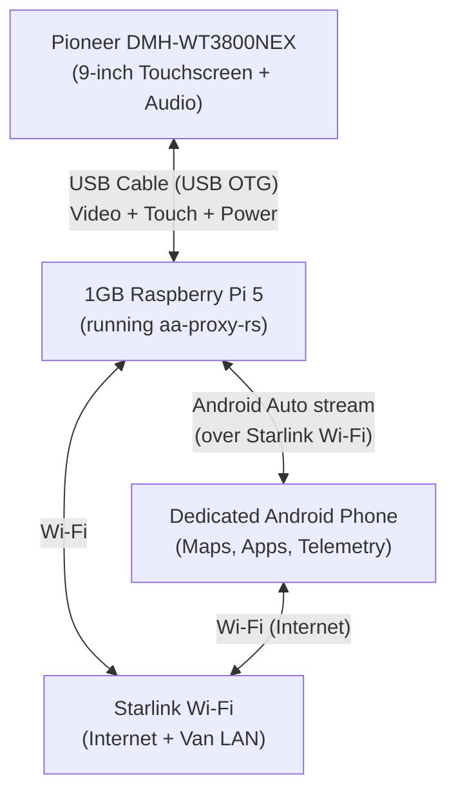

# Proposed Head Unit Bridge — 1GB Raspberry Pi 5 (`aa-proxy-rs`)

## Problem

Gomtuu's cab head unit is a **Pioneer DMH-WT3800NEX** (9-inch 1024×600 capacitive touchscreen, wired and wireless Android Auto / CarPlay, no HDMI input).

When an Android phone connects to the DMH-WT3800NEX via **Wireless Android Auto**, the Pioneer spins up an isolated 5 GHz Wi-Fi access point (`[Select Wi-Fi] -> [Smartphone]` mode) and forces the phone to disconnect from Starlink Wi-Fi to join the Pioneer's private network. Because the Pioneer has no internet uplink of its own, Android falls back to cellular data. In remote areas with no cell signal, the phone loses all internet connectivity (breaking navigation, maps, streaming, and cloud queries) even though Starlink is live in the van.

Additionally, the DMH-WT3800NEX's `[Hotspot]` Wi-Fi client mode (which connects the receiver to an external router for built-in Pioneer weather/OTA widgets) is mutually exclusive with Wireless Android Auto and does not route internet to a connected phone.

## Proposed Architecture

Wire the **1GB Raspberry Pi 5** directly to the Pioneer head unit's rear USB port in **USB Gadget (OTG) mode**, running [`aa-proxy-rs`](https://github.com/aa-proxy/aa-proxy-rs), while a **dedicated Android phone** (and/or any phone in the van) remains connected to **Starlink Wi-Fi**.

### Connection Flow

1. **Dedicated Android Phone ↔ Starlink Wi-Fi**: The phone stays on Starlink Wi-Fi continuously, keeping full internet access, Tailscale connectivity, and MQTT telemetry (`gps/phone/#`, etc.) without needing USB-C Ethernet adapters or cab wiring to the phone.
2. **1GB Raspberry Pi 5 ↔ Starlink Wi-Fi**: The 1GB Pi 5 joins the same Starlink Wi-Fi network (and Tailscale).
3. **1GB Raspberry Pi 5 ↔ Pioneer DMH-WT3800NEX (Wired USB OTG)**:
   - Connected via the Pi 5's USB-C port (configured in peripheral/OTG mode) to the Pioneer's USB port.
   - Powered directly by the Pioneer's USB port (up to 1.5A / 7.5W, while the Pi 5 in headless bridge mode draws ~2.5–3.5W), so the Pi powers on automatically with the head unit and draws 0W when the head unit is off.
4. **Phone ↔ 1GB Pi 5 (over Starlink Wi-Fi)**:
   - On boot, `aa-proxy-rs` advertises over Bluetooth to the phone.
   - Instead of spinning up a separate Wi-Fi hotspot that pulls the phone off Starlink, `aa-proxy-rs` (in client/station mode) directs the phone to open the Android Auto projection stream to the Pi's IP on the existing Starlink Wi-Fi LAN.
   - `aa-proxy-rs` pipes the H.264 video and audio stream into the Pioneer over USB and forwards all capacitive touch events, microphone input, and button presses from the Pioneer back to the phone.

---

## 1GB Raspberry Pi 5 Software Stack

Because this node acts as a thin, headless hardware bridge that is hard-powered-off whenever the head unit or ignition turns off, fast boot time (~3–5 seconds) and power-loss immunity (running from RAM / read-only rootfs) take priority over running a full Debian install.

### Layer-by-Layer Stack

1. **Base OS (In-RAM Embedded Linux)**:
   - Runs entirely in RAM (`tmpfs` / read-only `squashfs`) so cutting power at the head unit never corrupts the SD card.
   - Prototype target: **Alpine Linux (`aarch64` Diskless Mode)**.
   - Long-term appliance target: **Custom Buildroot Image (`aa-proxy-buildroot`)**.
2. **Linux Kernel USB Gadget Subsystem (`dwc2` + `ConfigFS`)**:
   - `/boot/firmware/config.txt` enables peripheral mode on the Pi 5's USB-C port: `dtoverlay=dwc2,dr_mode=peripheral`.
   - Kernel module `libcomposite` exposes `/sys/kernel/config/usb_gadget`.
   - Presents **AOAP (Android Open Accessory Protocol)** descriptors (`VID 0x18D1`, `PID 0x2D00`/`0x2D01`) to the Pioneer's USB port so the head unit recognizes the Pi as a wired Android phone.
3. **Bridge Daemon (`aa-proxy-rs`)**:
   - Single compiled `aarch64` Rust binary using `io_uring` for low-latency USB ↔ TCP forwarding.
   - Manages the `BlueZ` Bluetooth handshake, `ConfigFS` USB gadget state transitions, and the local web UI / optional packet hooks (DPI overrides, removing tap restrictions, etc.).
4. **Tailscale & Headless Management (`tailscaled` + `dropbear`)**:
   - Static `arm64` `tailscale` / `tailscaled` binaries baked into the image, initialized in the background *after* `aa-proxy-rs` starts so Tailscale never delays the Android Auto handshake on boot.
   - State file (`tailscaled.state`) stored on the persistent data partition alongside `aa-proxy-rs`'s `config.toml` and Bluetooth pairing keys so the node keeps its tailnet identity across reboots.
   - **Headless config & updates**:
     - **Tailscale SSH** (`tailscale up --ssh`) provides authenticated SSH over the tailnet directly through `tailscaled` with no extra daemon overhead.
     - **Dropbear SSH** (included by default in both Alpine and `aa-proxy-buildroot`) provides lightweight (~100 KB) local LAN SSH fallback.
     - **`aa-proxy-rs` Web UI & OTA**: Exposes a built-in HTTP configuration interface and supports over-the-air firmware/config updates.

---

## OS Image Comparison: Raspberry Pi OS Lite vs. Alpine Diskless vs. Buildroot

| Metric | Raspberry Pi OS Lite (Debian) | Alpine Linux (Diskless RAM Mode) | Custom Buildroot (`aa-proxy-buildroot`) |
|---|---|---|---|
| **Role in Plan** | Not recommended (too heavy) | **Phase 1 Prototype** | **Phase 2 Production Appliance** |
| **Boot Time (Power → AA Ready)** | ~20–30 seconds | **~4–6 seconds** | **~3–5 seconds** |
| **Idle RAM Usage** | ~150–200 MB | **~35–50 MB** | **~25–40 MB** |
| **Image Size** | ~2.5 GB | **~60–90 MB** | **~40–70 MB** |
| **Hard Power-Off Safety** | Read-write `ext4` by default (risks SD corruption unless `overlayfs` is maintained) | **100% RAM rootfs** (changes saved explicitly via `lbu commit`) | **100% RAM / read-only `squashfs`** (separate `/data` partition for config) |
| **Pi 5 Support** | Native out of the box | **Native out of the box** (`alpine-rpi-aarch64`) | Requires adding `raspberrypi5` board target to `aa-proxy-buildroot` |
| **Adding Tailscale** | `apt install tailscale` | **`apk add tailscale`** + `lbu commit` | Drop static `arm64` binaries into Buildroot `rootfs_overlay` |
| **Iteration Speed** | Fast (live package manager) | **Fast** (live `apk` + commit to SD) | Slower (~30–45 min initial cross-compile per image build) |

---

## Implementation Path

### Stage 1: Prototype on Alpine Linux (Diskless Mode)
- Flash official `alpine-rpi-aarch64` onto the 1GB Pi 5 SD card.
- Configure `config.txt` (`dtoverlay=dwc2,dr_mode=peripheral`) and load `libcomposite`.
- Configure `wpa_supplicant` for Starlink Wi-Fi and install `bluez`, `tailscale`, and the compiled `aarch64` `aa-proxy-rs` binary.
- Ensure the OpenRC init order starts `aa-proxy-rs` immediately after local networking/Bluetooth and launches `tailscaled` asynchronously in the background.
- Persist configuration (`config.toml`, Bluetooth keys, `/var/lib/tailscale/tailscaled.state`) to the SD card via `lbu commit`.

### Stage 2: Production Buildroot Image (`aa-proxy-buildroot`)
- Fork/extend `aa-proxy-buildroot` with a `raspberrypi5` board configuration (Pi 5 kernel + RP1 peripheral drivers + `dwc2` USB-C gadget tree).
- Add a Buildroot `rootfs_overlay` containing:
  - Static `tailscale` and `tailscaled` binaries in `/usr/sbin/`.
  - An init script starting `tailscaled --state=/data/tailscale/tailscaled.state` in the background.
- Produce a single flashable `.img` / `.swu` firmware artifact for the 1GB Pi 5.
